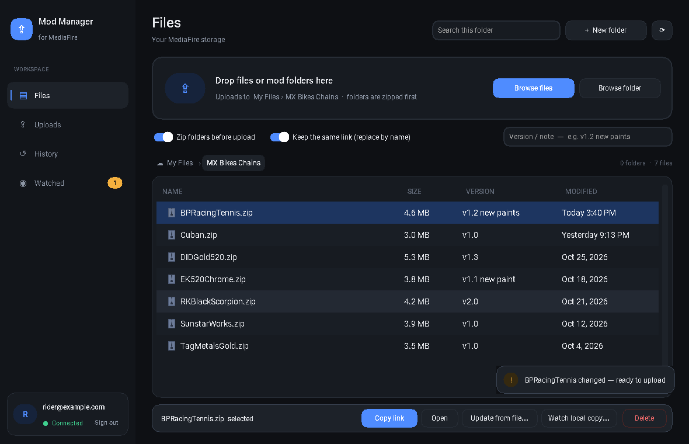
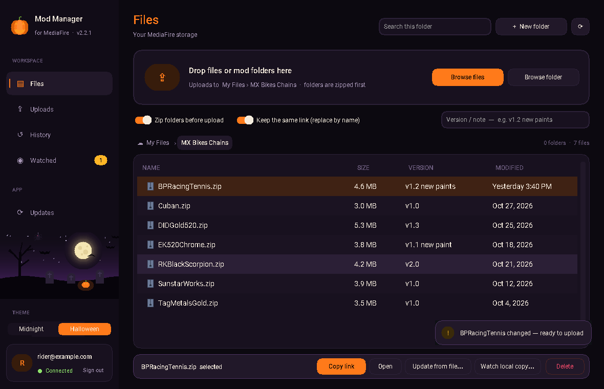
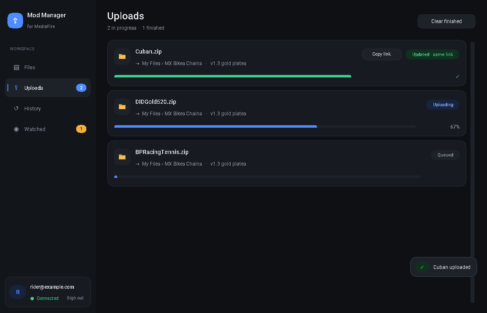
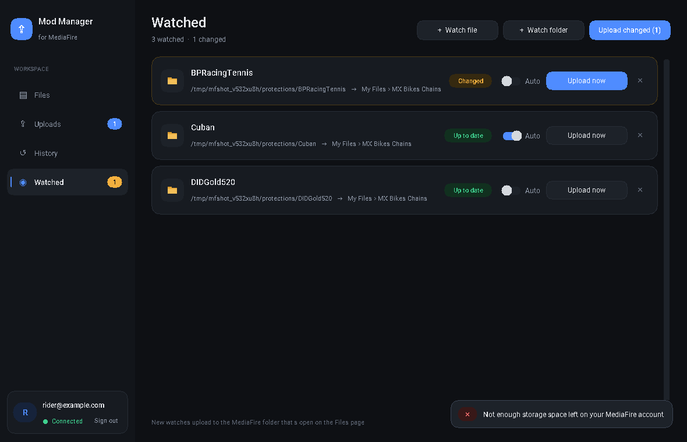
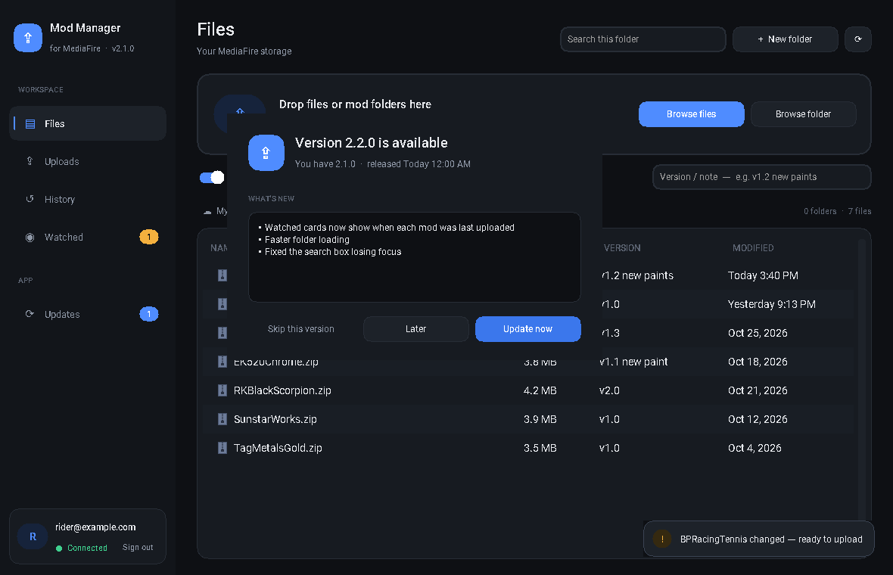

# Terps WorkFlow

Terps WorkFlow (formerly MediaFire Mod Manager) is a Windows app for uploading mods to MediaFire. You drag and drop files, and updates to a mod keep the same download link. Mod folders are zipped automatically, there's a version history, and you can watch folders on your PC for changes. The app also updates itself from this repo's releases.





## Download

Get **TerpsWorkFlow.exe** from the [latest release](../../releases/latest) and run it. You don't need to install anything. After that the app keeps itself up to date.

## What it does

- **Drag and drop** files or mod folders onto the window. They upload to the MediaFire folder you have open.
- **Keeps the same link.** If a file with the same name already exists, it's updated in place, so links you've posted keep working.
- **Auto-zip.** Dropping `BPRacingTennis` uploads `BPRacingTennis.zip`, with the folder at the top level inside.
- **History.** Every upload is logged with its time, your version note, its size and its link.
- **Watched folders.** When a mod changes on your PC, the app tells you. Turn on Auto and it uploads by itself.
- **Storage meter.** See how much of your MediaFire storage you're using at the bottom of the sidebar; click it for details.
- **Themes.** Click the gear next to the app name to open Settings and pick a theme: Midnight, Halloween, Terps, Ocean, Sunset, Racing, Neon or Arctic (light). The Halloween theme has a flickering jack-o'-lantern and a night-sky scene where bats dodge your cursor.
- **Self-updating.** When the app opens it checks for a newer release here, shows what's new and installs it.

| Uploads | Watched | Update prompt |
|---|---|---|
|  |  |  |

### First run

Log in with your MediaFire email and password. "Remember me" saves the password in Windows Credential Manager, not in a file. If you sign in to MediaFire with Google or Facebook, set a regular password in your MediaFire account settings first.

### Where things are saved

| File | What |
|---|---|
| `%APPDATA%\MediaFireModManager\config.json` | settings and watched folders |
| `%APPDATA%\MediaFireModManager\history.json` | upload log |

## Releasing a new version

GitHub builds the exe for you.

1. Make your changes.
2. Raise `VERSION` in [`app_version.py`](app_version.py) (e.g. `2.2.0` → `2.3.0`). Add a section for it at the top of [CHANGELOG.md](CHANGELOG.md). That text is what people see in the "Update available" window.
3. Commit and push to `main`.

The [Build and release](.github/workflows/release.yml) action sees the new version number and builds the exe on Windows. It checks that the exe starts and reports the right version, then posts it as release `v2.3.0`. Every copy of the app offers the update the next time it opens. Pushes that don't change the version don't make a release.

Other ways to start a release: on the GitHub website go to **Actions → Build and release → Run workflow** and type a version, or push a tag like `v2.3.0`.

Version numbers must go up. The app only offers a release that's newer than what it's running.

## Building it yourself

You need Python 3.9 or newer from python.org; tick "Add python.exe to PATH" when you install it. Then double-click `build.bat`. It installs the requirements, asks for a version number and builds `dist\TerpsWorkFlow.exe`. Local builds are for testing. Releases come from GitHub as described above.

To run from source without building:

```
pip install -r requirements.txt
python mediafire_mod_manager.py
```

## Files

| File | What it is |
|---|---|
| `mediafire_mod_manager.py` | the app (window, uploads, history, watched folders, updates) |
| `mediafire_api.py` | MediaFire API client (login, folders, uploads that keep the link) |
| `updater.py` | checks GitHub releases, downloads and checks the new exe, swaps it in |
| `app_version.py` | version number and update source (written by `set_version.py`) |
| `set_version.py` | stamps the version for `build.bat` and the GitHub build |
| `make_icon.py` | draws the logo and writes `assets/terps_workflow.ico` and the logo PNGs |
| `release_notes.py` | pulls a version's notes out of CHANGELOG.md for the release |
| `.github/workflows/release.yml` | builds and publishes releases |

## Notes

- Uploads use MediaFire's public SDK app ID, so you don't need a MediaFire developer key.
- Each file is uploaded in one piece. That's fine for mod-sized files, but very large files (several GB) may be slow or rejected depending on your MediaFire plan.
- The update is checked against a SHA-256 checksum before it's installed. If anything doesn't match, nothing changes.
